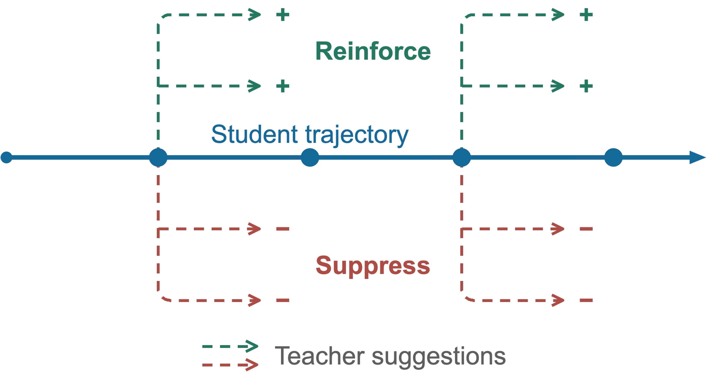

# AOPD: When to Follow the Teacher

*Advantage-Based On-Policy Distillation for math, coding, medical QA, and biology.*

## Abstract

Online Policy Distillation (OPD) often outperforms offline methods such as Supervised Fine-Tuning (SFT) by training on trajectories sampled directly from the student. However, standard OPD trains the student to follow the teacher at every state of the trajectory, assuming that teacher guidance is always beneficial. We instead distinguish between what the teacher prefers and what actually helps the current student succeed. We introduce Advantage-Based On-Policy Distillation (AOPD), which weights teacher actions by their counterfactual advantage under the student. Teacher actions that improve the student’s expected outcome are reinforced, while those that do not are downweighted.

Directly computing these advantages requires trying alternative teacher actions at each step and running new rollouts from each. Instead, we show that the AOPD objective can be estimated using only standard student rollouts and their terminal rewards. Our estimator uses teacher importance weights on the student-sampled actions to provide unbiased advantage-weighted supervision, without any additional rollouts or reward evaluations. This allows AOPD to focus teacher supervision on actions that help the current student while preserving the rollout efficiency of standard OPD. Experiments on math, coding, and Medqa show gains over distillation and RL baselines in both external-teacher and self-distillation settings. 



## Getting Started

Use Python 3.11 and separate environments for the two settings:

```bash
# External teacher
pip install -r training/external_teacher/requirements.txt
pip install flash-attn==2.7.3 --no-build-isolation

# Self-distillation — in a separate environment
pip install -r training/self_distillation/requirements.txt
pip install flash-attn==2.8.3 --no-build-isolation
```

Launchers use eight GPUs, BF16, and LoRA (`r=64`, `alpha=128`).

## Training

Each setting has one `train.py` and one `trainer.py`, in [`training/external_teacher/`](training/external_teacher/) and [`training/self_distillation/`](training/self_distillation/). Self-distillation also keeps the upstream OPSD base in `opsd.py` and task data/rewards in `tasks.py`.

All launchers are in [`scripts/`](scripts/). The first argument selects the student model; optional training arguments follow it.

| Script | Task / data | Steps | Training tokens |
| :--- | :--- | ---: | ---: |
| `run_external_math.sh` | OpenThoughts math | 450 | 8192 |
| `run_external_code.sh` | Verified TACO | 350 | 4096 |
| `run_self_math.sh` | OpenThoughts math | 400 | 8192 |
| `run_self_medical.sh` | MedMCQA | 300 | 2048 |
| `run_self_biology.sh` | SciKnowEval biology | 400 | 4096 |
| `run_self_code.sh` | DeepCoder TACO | 400 | 4096 |

**External teacher:** Qwen3-1.7B is the student; the math teacher is Qwen3-4B-Instruct-2507 and the coding teacher is Qwen3-8B.

```bash
bash scripts/run_external_math.sh Qwen/Qwen3-1.7B
bash scripts/run_external_code.sh Qwen/Qwen3-1.7B
```

**Self-distillation:** the frozen base model sees a reference solution; the student sees only the problem. Math uses Qwen3-1.7B/8B; the other tasks use Qwen2.5-7B-Instruct or Qwen3-4B-Instruct-2507.

```bash
bash scripts/run_self_math.sh Qwen/Qwen3-8B
bash scripts/run_self_medical.sh Qwen/Qwen2.5-7B-Instruct
bash scripts/run_self_biology.sh Qwen/Qwen3-4B-Instruct-2507
bash scripts/run_self_code.sh Qwen/Qwen3-4B-Instruct-2507
```

**Data:** math and medical training load the released datasets directly. Prepare biology and coding data once:

```bash
python -m data.prepare --task biology
python -m data.prepare --task code
# External coding requires SandboxFusion running in a separate terminal:
docker run --rm -p 127.0.0.1:8080:8080 volcengine/sandbox-fusion:server-20250609
python -m data.prepare --task external_code
```

Self-coding executes Python in Docker. Pull its pinned runtime before training:

```bash
docker pull ghcr.io/nuprl/multipl-e-evaluation@sha256:2cb4fcd74d89d149f7a3feb177f7d8169cef390a7ea7951c9b84e7ff59ea26cc
```

**Settings:** paper defaults use non-thinking prompts, batch 32 on eight GPUs, four responses per group, temperature 0.8, top-p 1, and no sampling top-k pruning. Learning rate is `2e-5`, except Qwen3 biology uses `1e-5`. Override directly, e.g. append `--learning_rate 1e-5 --output_dir outputs/my_run`.

**All-wrong KL:** `--mu` adds forward KL only when every response in a group fails. It defaults to 0.08 for external math and zero otherwise; wrong responses in mixed groups do not receive this extra KL.

**Residual:** clipping at `4 × student_probability` leaves some teacher mass unused. The original bounded sigmoid correction discourages that leftover mass on positive-advantage responses and encourages it on negative-advantage responses. Both trainers retain this term separately from all-wrong KL.

## Evaluation

Evaluation code is in [`eval/`](eval/). Install `evalplus` for coding:

```bash
pip install evalplus
```

**Math** — AIME, AMC, HMMT, MATH-500, Minerva, OpenThoughts:

```bash
python -m eval.math --model_path outputs/RUN/merged --exp_name RUN \
  --dataset aime --max_tokens 16192 --prompt_style self
```

Use `--prompt_style external` for external-teacher math. The evaluator retains temperature-0.6 sampling; OpenThoughts here is a development diagnostic.

**Coding** — HumanEval+ and MultiPL-E:

```bash
evalplus.evaluate --model outputs/RUN/merged --dataset humaneval --backend vllm --greedy
python -m eval.multiple --model outputs/RUN/merged --lang java --out_dir results/multiple/java
```

Score MultiPL-E outputs with its [official evaluator](https://github.com/nuprl/MultiPL-E). Pass@10 requires at least ten sampled completions; greedy evaluation provides pass@1.

**Medical and biology:** prepare benchmark inputs with `python -m data.prepare --task medical` or `--task mmlupro`, then:

```bash
python -m eval.qa --model outputs/RUN/merged --task medical \
  --data data/medical/medqa_test.jsonl --output results/medqa.jsonl
python -m eval.qa --model outputs/RUN/merged --task biology \
  --data data/biology/source50.jsonl --output results/biology.jsonl
python -m eval.qa --model outputs/RUN/merged --task mmlupro \
  --data data/mmlupro717.jsonl --output results/mmlupro.jsonl
```

QA uses the original task parsers and saves raw answers. Medical defaults to 8192 tokens; biology/MMLU-Pro use 4096. Match prompts and decoding budgets across checkpoints.